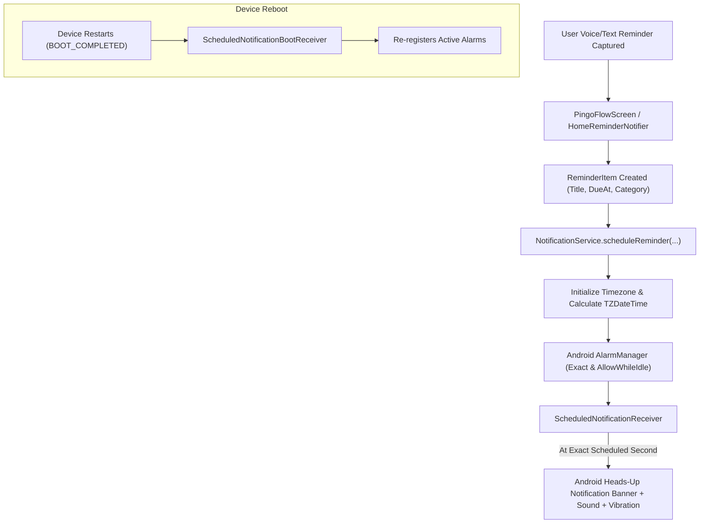

# Pingo Feature Specification: Local Notifications & Exact Alarms

**Feature ID**: `17`  
**Title**: Zero-Knowledge Local Push Notifications and Punctual Alarm Scheduler  
**Status**: `Planned / In-Progress`  
**Target Platform**: Android (API 26+) & iOS (iOS 14+)  
**Architecture**: Offline-first, Zero-Knowledge, Exact Alarm Scheduling  

---

## 1. Executive Summary & Objective

Pingo operates on a zero-knowledge, privacy-first paradigm. Reminders must alert users at the exact second configured—even when offline, in airplane mode, or with the application completely closed—without relying on third-party cloud push servers that leak reminder metadata.

This specification details the implementation of **`flutter_local_notifications`** combined with **`timezone`** to provide:
1. Punctual exact alarms on Android (`SCHEDULE_EXACT_ALARM` / `USE_EXACT_ALARM`).
2. High-priority Android notification channels (Sound, Vibration, Banner alerts).
3. Automatic re-scheduling upon device reboot (`RECEIVE_BOOT_COMPLETED`).
4. Seamless integration with Pingo's reminder state management.

---

## 2. Technical Stack & Dependencies

| Dependency | Purpose | Target Version |
| :--- | :--- | :--- |
| `flutter_local_notifications` | Native Android AlarmManager & NotificationManager bridge | `^17.2.3` |
| `timezone` | Timezone-aware timestamp calculation (`TZDateTime`) | `^0.9.4` |

---

## 3. Architecture & Data Flow

---

## 4. Android Channels & Reliability Specification

### 4.1 Channels
1. **Pingo Reminders Channel (`pingo_reminders`)**:
   - Name: `Pingo Reminders`
   - Description: `Standard notifications for scheduled tasks and alarms`
   - Importance: `Importance.max`
   - Priority: `Priority.high`
   - Vibrate: `true`
   - Play Sound: `true`
   - Enable Lights: `true`

2. **Pingo Urgent Channel (`pingo_urgent`)**:
   - Name: `Urgent Reminders`
   - Description: `Critical medicine and high-priority alarms`
   - Importance: `Importance.max`
   - Priority: `Priority.max`
   - Full-Screen Intent: `true`

### 4.2 System Permissions
- `android.permission.POST_NOTIFICATIONS`: Requested dynamically at runtime on Android 13+ (API 33+).
- `android.permission.SCHEDULE_EXACT_ALARM`: For exact-to-the-second trigger timing.
- `android.permission.RECEIVE_BOOT_COMPLETED`: Reschedules pending notifications after phone restart.
- `android.permission.VIBRATE` & `android.permission.WAKE_LOCK`.

---

## 5. File Impact Analysis

| File Path | Action | Description |
| :--- | :--- | :--- |
| `apps/mobile/pubspec.yaml` | `Modify` | Add `flutter_local_notifications` and `timezone` dependencies. |
| `apps/mobile/lib/core/services/notification_service.dart` | `Create` | Core notification singleton service with initialization, channel setup, and scheduling APIs. |
| `apps/mobile/lib/main.dart` | `Modify` | Initialize `NotificationService` and timezone database at application startup. |
| `apps/mobile/lib/features/home/presentation/state/home_reminder_provider.dart` | `Modify` | Trigger notification scheduling on `addReminder` / `snooze` and cancellation on `deleteReminder` / `toggleDone`. |
| `apps/mobile/lib/features/session_chat/presentation/screens/pingo_flow_screen.dart` | `Modify` | Schedule notifications upon saving auto-saved reminders. |
| `apps/mobile/android/app/src/main/AndroidManifest.xml` | `Verify` | Ensure boot receiver and notification receivers are declared. |

