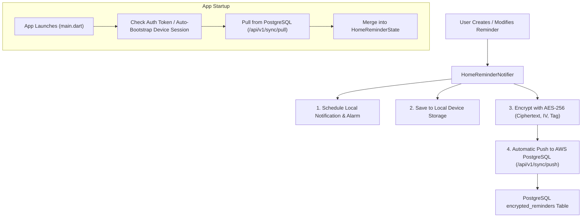

# Pingo Feature Specification: Automatic Database Persistence & Cloud Sync

**Feature ID**: `18`  
**Title**: Automatic Dual Database Persistence (Local Device Cache + AWS Cloud PostgreSQL Zero-Knowledge Sync)  
**Status**: `Planned`  
**Target Platform**: Android & iOS  
**Architecture**: Offline-First, Zero-Knowledge AES-256-GCM, Automatic Cloud Push  

---

## 1. Executive Summary & Objective

Every reminder captured via voice or text must be permanently saved to the database. If the user closes the app, reboots their phone, or logs in from another device, their reminders must never be lost.

This specification details the automatic persistence pipeline:
1. **Device-Level Persistent Cache**: Instant write to local storage so the UI loads instantaneously even offline.
2. **Silent Zero-Knowledge Cloud Provisioning**: Automatic device account registration to acquire JWT tokens without forcing the user through annoying login screens.
3. **Automatic Cloud Push**: Every reminder creation, completion toggle, snooze, or deletion automatically syncs to the AWS PostgreSQL `encrypted_reminders` table.
4. **App Launch Sync**: Automatic pull on app start to synchronize any remote changes.

---

## 2. Technical Architecture & Data Flow



---

## 3. Database Schema Mapping (AWS PostgreSQL)

The AWS server database `pingo_db` stores reminders in the `encrypted_reminders` table:

```sql
CREATE TABLE encrypted_reminders (
    id UUID PRIMARY KEY,
    user_id UUID REFERENCES users(id) ON DELETE CASCADE,
    ciphertext TEXT NOT NULL,
    iv TEXT NOT NULL,
    auth_tag TEXT NOT NULL,
    due_at TIMESTAMPTZ,
    is_completed BOOLEAN DEFAULT FALSE,
    version INT DEFAULT 1,
    created_at TIMESTAMPTZ DEFAULT NOW(),
    updated_at TIMESTAMPTZ DEFAULT NOW(),
    deleted_at TIMESTAMPTZ
);
```

---

## 4. Implementation Steps & File Impact Analysis

| File Path | Action | Description |
| :--- | :--- | :--- |
| `apps/mobile/pubspec.yaml` | `Modify` | Add `shared_preferences: ^2.2.3` for local device persistence. |
| `apps/mobile/lib/core/storage/local_storage_service.dart` | `Create` | Local disk storage service for reminders and auth tokens. |
| `apps/mobile/lib/features/auth/presentation/state/auth_provider.dart` | `Modify` | Auto-bootstrap anonymous device session if token is absent. |
| `apps/mobile/lib/features/home/presentation/state/home_reminder_provider.dart` | `Modify` | Auto-trigger `pushToServer` on every create, update, delete, and auto-pull on init. |
| `apps/mobile/lib/features/home/presentation/screens/pingo_home_screen.dart` | `Modify` | Call initial sync and display live reminder badges/count on home screen. |

