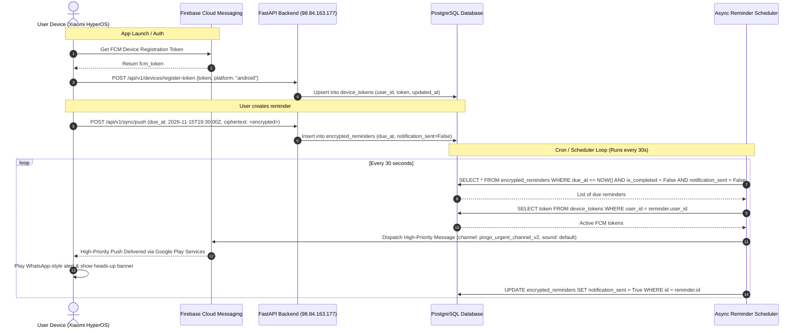

# Feature Specification: Firebase Cloud Messaging (FCM) Backend Push Engine

**Document ID**: `docs/features/22_firebase_cloud_messaging_backend_push_spec.md`  
**Status**: APPROVED / IMPLEMENTATION  
**Primary Architect**: Principal System Architect & Staff Full-Stack Engineer  
**Security Tier**: Level 1 (Zero-Knowledge E2EE Integrity Preserved)  

---

## 1. Problem Statement & Motivation

On modern Android devices—particularly OEM skins like Xiaomi HyperOS/MIUI, Samsung OneUI, and Huawei EMUI—background services and `AlarmManager` alarms are aggressively killed or deferred when the device screen is locked or the app is swiped from recents.

While local notifications worked for instant triggers ("Test Alert"), scheduled future alarms failed to wake the phone punctually on Xiaomi HyperOS without manual user exemption of battery optimizations and autostart toggles.

### Solution Architecture
To guarantee 100% punctual reminder delivery that rings like an incoming WhatsApp or Telegram alert, Pingo integrates **Firebase Cloud Messaging (FCM)** with high-priority downstream delivery:
1. **Google Play Services Daemon**: Always runs at the OS level on Android; wakes the device immediately upon receiving FCM high-priority packets.
2. **FastAPI Background Dispatcher**: A resilient, non-blocking scheduler running every 30 seconds checks for due reminders and dispatches high-priority pushes directly to the user's active device tokens.
3. **Zero-Knowledge Privacy Guarantee**: Server only queries unencrypted timestamp index `due_at` and status `is_completed`. Encrypted reminder payloads remain client-side encrypted (AES-256-GCM).

---

## 2. End-to-End System Architecture



---

## 3. Data Models & Database Migrations

### 3.1 `device_tokens` Table
```sql
CREATE TABLE device_tokens (
    id UUID PRIMARY KEY DEFAULT gen_random_uuid(),
    user_id UUID NOT NULL REFERENCES users(id) ON DELETE CASCADE,
    token VARCHAR(512) NOT NULL UNIQUE,
    platform VARCHAR(32) NOT NULL DEFAULT 'android',
    created_at TIMESTAMP WITH TIME ZONE NOT NULL DEFAULT NOW(),
    updated_at TIMESTAMP WITH TIME ZONE NOT NULL DEFAULT NOW()
);

CREATE INDEX ix_device_tokens_user_id ON device_tokens(user_id);
```

### 3.2 `encrypted_reminders` Column Addition
```sql
ALTER TABLE encrypted_reminders
ADD COLUMN notification_sent BOOLEAN NOT NULL DEFAULT FALSE;

CREATE INDEX ix_encrypted_reminders_due_pending
ON encrypted_reminders(due_at, is_completed, notification_sent)
WHERE is_completed = FALSE AND notification_sent = FALSE;
```

---

## 4. API Specification

### `POST /api/v1/devices/register-token`
- **Authentication**: Bearer JWT Required
- **Request Body**:
```json
{
  "token": "dGVzdF9mY21fdG9rZW4...",
  "platform": "android"
}
```
- **Response**: `200 OK`
```json
{
  "status": "success",
  "message": "Device token registered successfully"
}
```

---

## 5. Security & Privacy Invariants

1. **Zero E2EE Compromise**: The backend pushes generic alert copy (`You have a reminder scheduled! 🐧`) or data envelopes. Plaintext user reminders are NEVER sent over FCM unencrypted.
2. **Credential Isolation**: `firebase-service-account.json` and `google-services.json` are excluded via `.gitignore` and must never be exposed or checked into public repositories.
3. **Token Lifecycles**: If FCM reports `UnregisteredError` or `InvalidArgumentError` when sending, the backend automatically deletes the stale token to avoid waste.
